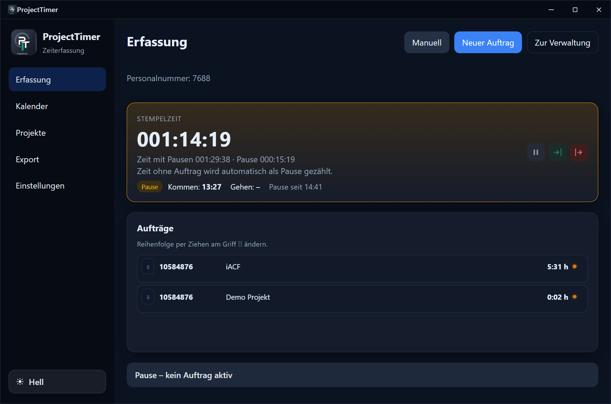
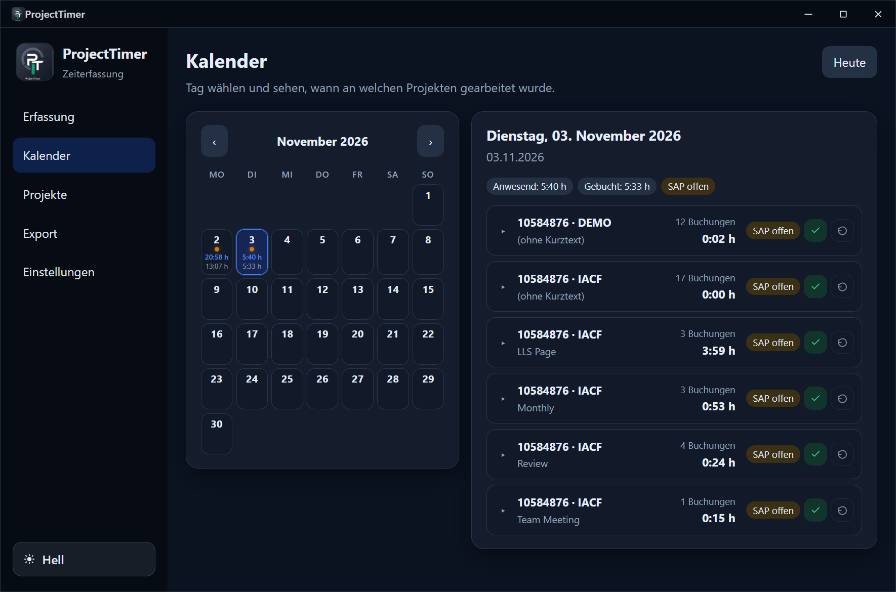
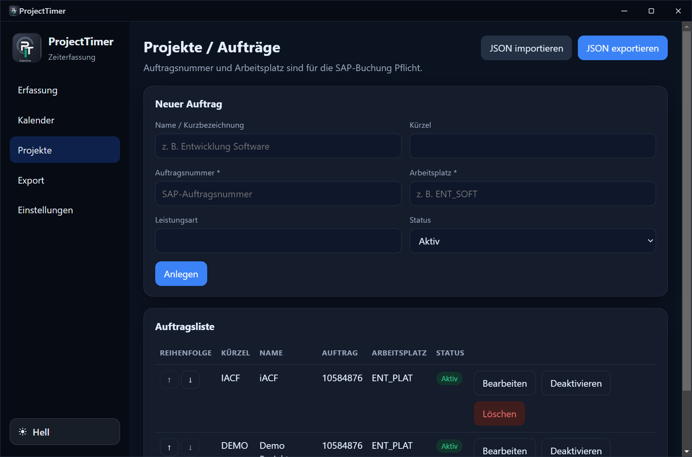
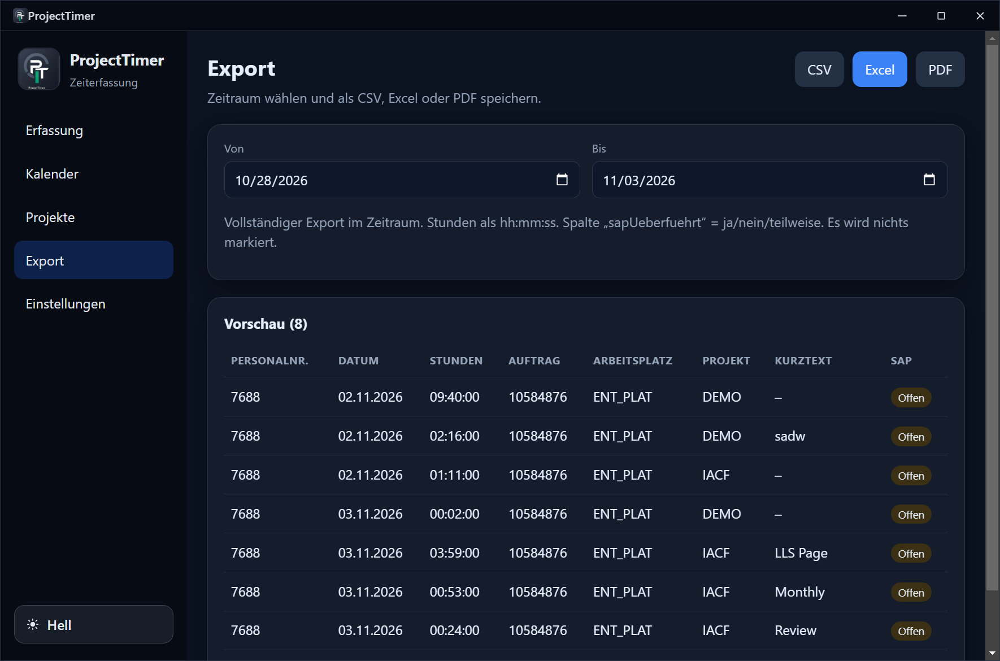
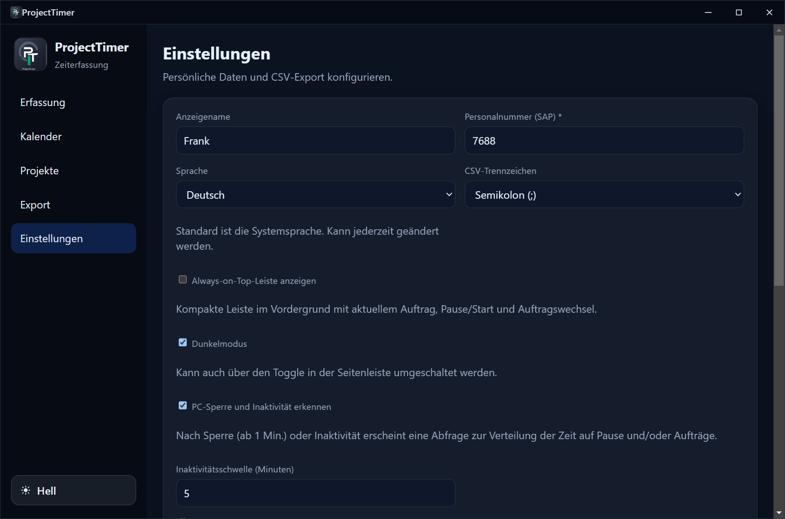

# ProjectTimer

**Desktop-Zeiterfassung für Windows** – Kommen/Gehen, Aufträge & Topics, Kalender, SAP-orientierter Export und optionale Always-on-Top-Leiste.



Lizenz: [MIT](LICENSE) · Version: **1.0.0** · Platform: **Windows**

---

## Inhaltsverzeichnis

- [Überblick](#überblick)
- [Funktionen](#funktionen)
- [Screenshots](#screenshots)
- [Installation für Nutzer](#installation-für-nutzer)
- [Schnelleinstieg](#schnelleinstieg)
- [Seiten im Detail](#seiten-im-detail)
- [Daten & Privatsphäre](#daten--privatsphäre)
- [Updates](#updates)
- [Entwicklung](#entwicklung)
- [Build & Release](#build--release)
- [Lizenz](#lizenz)

---

## Überblick

ProjectTimer hilft dabei, Arbeitszeit pro Auftrag zu erfassen und für die Weitergabe an SAP (oder ähnliche Systeme) vorzubereiten. Die App läuft lokal auf dem PC, speichert alles in einer SQLite-Datenbank und braucht keinen Server.

Typischer Tagesablauf:

1. App startet (optional mit Windows / Auto-Kommen).
2. **Kommen** stempeln, Auftrag oder Topic starten.
3. Pausen und Auftragwechsel werden mitgezählt.
4. Am Abend **Gehen** – oder vorläufig beim Herunterfahren.
5. Buchungen im **Kalender** prüfen, bei Bedarf bearbeiten.
6. Über **Export** als CSV / Excel / PDF speichern und als „in SAP überführt“ markieren.

---

## Funktionen

### Erfassung (Stempel & Aufträge)

- **Kommen / Gehen** mit Stempelzeit, Pause und „Zeit mit Pausen“
- Zeit ohne laufenden Auftrag zählt automatisch als Pause
- Aufträge starten/stoppen, Reihenfolge per Drag & Drop
- **Tages-Topics** mit optionalem SAP-Kurztext; Zeit ohne Kurztext bleibt am Auftrag
- Zeit ohne Kurztext auf Topics verteilen
- Manuelle Nachbuchungen (Stunden/Minuten)
- SAP-Status je Auftrag / Tag markieren oder zurücksetzen
- **Gleicher Tag:** Nach Gehen erneut Kommen → ursprüngliche Kommen-Zeit bleibt, Lücke wird Pause

### Kalender

- Monatsübersicht mit Punkten für Anwesenheit / gebuchte Zeit
- Tagesdetail: Anwesend vs. Gebucht, Gruppierung nach Projekt + Kurztext
- Rechtsklick: Buchung bearbeiten
- SAP-Markierung pro Gruppe oder Eintrag

### Projekte

- Aufträge mit Auftragsnummer, Arbeitsplatz, Empfängerart, Leistungsart
- Aktiv / inaktiv, Reihenfolge, Bearbeiten, Löschen
- JSON-Import/Export für Team-Stammdaten

### Export

- Zeitraum wählen, Vorschau
- **CSV**, **Excel**, **PDF**
- Optional nur offene Einträge; nach Speichern als überführt markieren
- Spalten in den Einstellungen konfigurierbar

### Always-on-Top / Slideout

- Kompakte Leiste im Vordergrund: Auftrag, Timer, Pause/Start
- Modi: frei schwebend oder an Kante (Slideout), Position merken
- Doppelklick öffnet die Hauptanwendung

### Automatisierung & Komfort

- Dark/Light-Mode, Deutsch / English (oder Systemsprache)
- Autostart mit Windows
- Auto-Kommen am ersten Start des Tages
- Vorläufiges Gehen bei Shutdown; Fortsetzen am selben Tag
- Erkennung von PC-Sperre / Inaktivität mit Zeitverteilung
- Tray-Integration

### Verteilung

| Variante | Datei | Updates |
| --- | --- | --- |
| **Installer (NSIS)** | `ProjectTimer-Setup-1.0.0.exe` | Auto-Download + „Jetzt installieren“ |
| **Portable** | `ProjectTimer-Portable-1.0.0.exe` | Hinweis + Download; Datei manuell ersetzen |

---

## Screenshots

### Erfassung

Tagesstempel, Pausen und Auftragsliste.


### Kalender

Monat wählen, Tag prüfen, Buchungen und SAP-Status.



### Projekte

Aufträge anlegen, sortieren, JSON teilen.



### Export

CSV / Excel / PDF mit Vorschau und SAP-Spalte.



### Einstellungen

Personalnummer, Sprache, Leiste, Idle-Erkennung, Autostart.



---

## Installation für Nutzer

### Option A – Installer (empfohlen bei Auto-Update)

1. Im [GitHub Release v1.0.0](https://github.com/DrScince/ProjectTimer/releases/tag/v1.0.0) die Datei **`ProjectTimer-Setup-1.0.0.exe`** laden.
2. Ausführen und Installationsordner wählen.
3. ProjectTimer starten (optional Autostart in den Einstellungen aktivieren).

Windows SmartScreen kann ohne Code-Signing warnen: *Weitere Informationen* → *Trotzdem ausführen*.

### Option B – Portable (ohne Installation)

1. **`ProjectTimer-Portable-1.0.0.exe`** laden.
2. An beliebigen Ort legen und starten.
3. Updates: In-App-Hinweis → **Herunterladen** → alte Datei durch neue ersetzen.  
   Einstellungen und Zeiten bleiben in `%AppData%\ProjectTimer\` erhalten.

---

## Schnelleinstieg

1. **Einstellungen:** Personalnummer (SAP) eintragen, Anzeigename, ggf. Autostart.
2. **Projekte:** Aufträge mit Auftragsnummer und Arbeitsplatz anlegen (oder JSON importieren).
3. **Erfassung:** **Kommen** → Auftrag oder Topic starten → bei Bedarf pausieren → **Gehen**.
4. **Kalender:** Tag kontrollieren, Buchungen korrigieren.
5. **Export:** Zeitraum wählen → CSV/Excel/PDF → nach SAP-Übernahme markieren.

---

## Seiten im Detail

### Erfassung

| Element | Bedeutung |
| --- | --- |
| Stempelzeit | Zeit seit Kommen abzüglich erfasster Pausenlogik |
| Zeit mit Pausen | Gesamte Anwesenheitsdauer inkl. Pausen |
| Kommen / Gehen | Tagesanwesenheit; erneutes Kommen am selben Tag setzt fort |
| Aufträge | Timer je Projekt; kompakt, Details bei aktivem Auftrag |
| Topics | Optionaler Kurztext für den Tag |
| Manuell | Nachtragen ohne laufenden Timer |
| SAP | Offen / gebucht / teilweise |

### Kalender

- Anwesend = gestempelte Anwesenheit  
- Gebucht = Summe der Zeitbuchungen  
- Farbige Punkte = SAP-Status am Tag  

### Export-Hinweise

- Stundenformat `hh:mm:ss`
- Spalte `sapUeberfuehrt`: ja / nein / teilweise
- CSV-Trennzeichen und Spalten unter Einstellungen

---

## Daten & Privatsphäre

| Was | Wo |
| --- | --- |
| Datenbank | `%AppData%\ProjectTimer\projecttimer.db` |
| Einstellungen | in derselben lokalen DB |
| Netzwerk | optional nur für GitHub-Update-Checks / Download |

Es gibt keine Cloud-Synchronisation. Backup = Kopie der `.db`-Datei.

---

## Updates

### Installer

Die App prüft GitHub Releases, lädt Updates herunter und zeigt einen Banner (**Jetzt installieren**).

### Portable

Bei neuer Version erscheint ein Hinweis mit **Herunterladen**. Die portable EXE manuell austauschen; Nutzerdaten bleiben in AppData.

---

## Entwicklung

### Voraussetzungen

- Windows
- Node.js 20+ (LTS empfohlen)

### Setup

```bash
npm install
npm run rebuild
npm run dev
```

Falls `electron.exe` fehlt:

```bash
node scripts/install-electron.js
npm run rebuild
```

### Nützliche Scripts

| Script | Zweck |
| --- | --- |
| `npm run dev` | Entwicklung mit Hot-Reload |
| `npm run build` | Produktions-Bundle |
| `npm run dist` | Installer + Portable unter `dist/` (ohne Publish) |
| `npm run release` | Build + Publish zu GitHub Releases |

Stack: Electron, electron-vite, React, TypeScript, better-sqlite3, electron-builder, electron-updater.

---

## Build & Release

```bash
npm run dist
```

Erzeugt u. a.:

- `dist/ProjectTimer-Setup-<version>.exe`
- `dist/ProjectTimer-Portable-<version>.exe`

### Version 1.0.0 veröffentlichen

1. Version in `package.json` setzen (`1.0.0`).
2. Auf `main` committen und pushen.
3. Tag setzen:

```bash
git tag v1.0.0
git push origin v1.0.0
```

Der Workflow [`.github/workflows/release.yml`](.github/workflows/release.yml) baut auf `windows-latest` und veröffentlicht das Release inkl. Update-Metadaten für den Installer.

---

## Lizenz

Dieses Projekt steht unter der **MIT License** – siehe [LICENSE](LICENSE).

```
Copyright (c) 2026 ProjectTimer contributors
```
